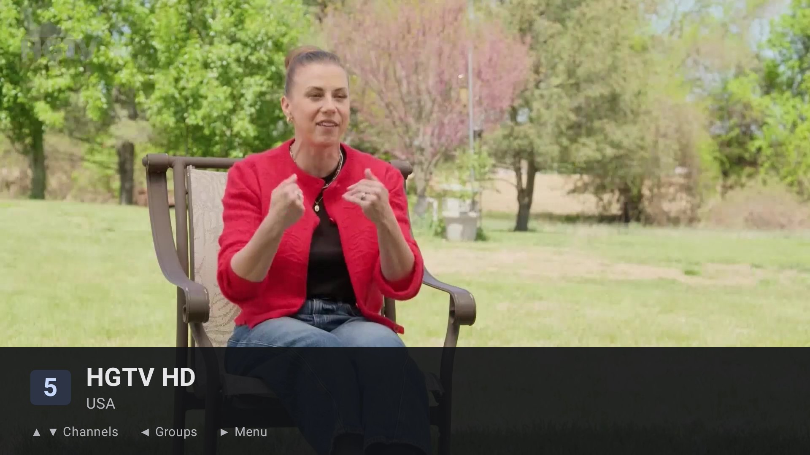
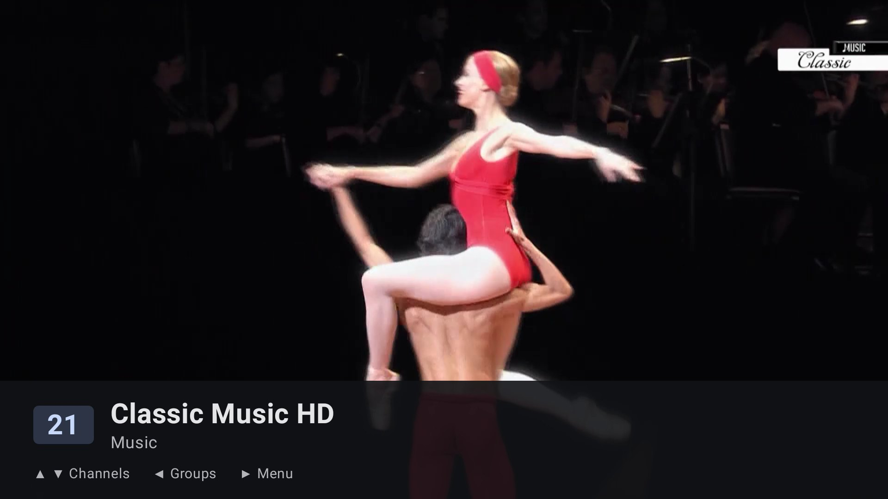
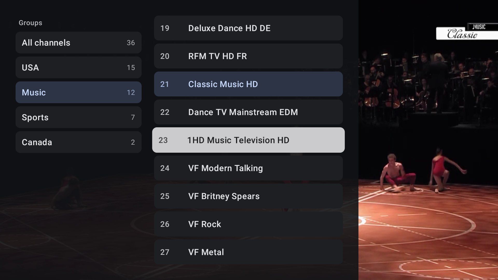
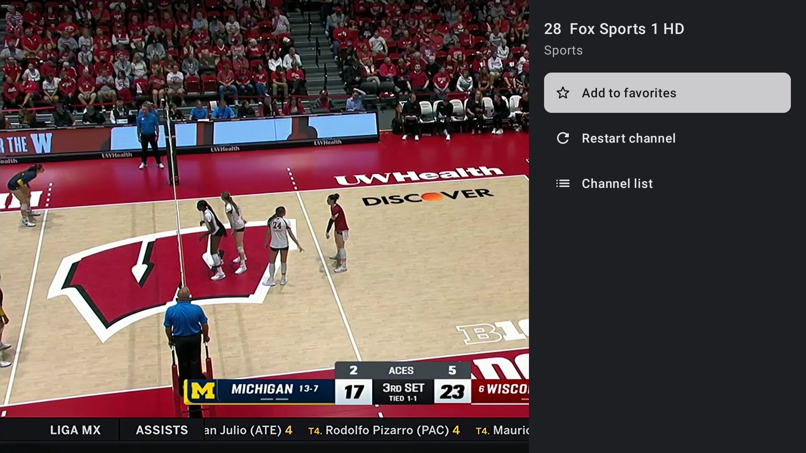
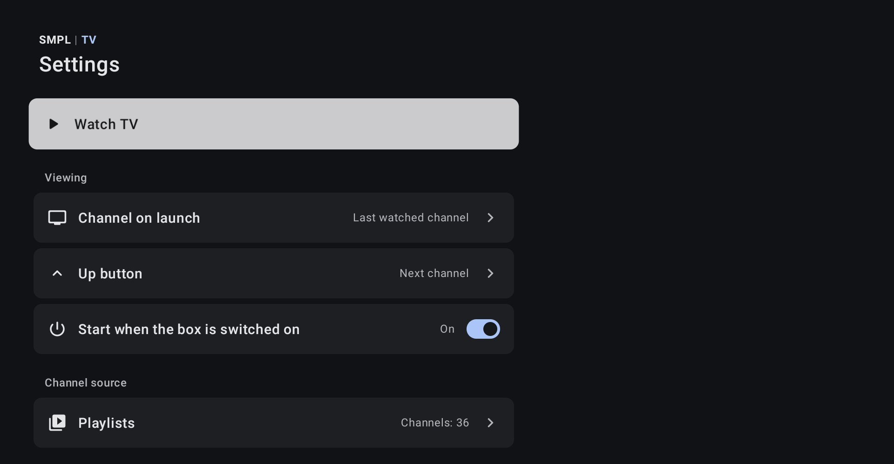
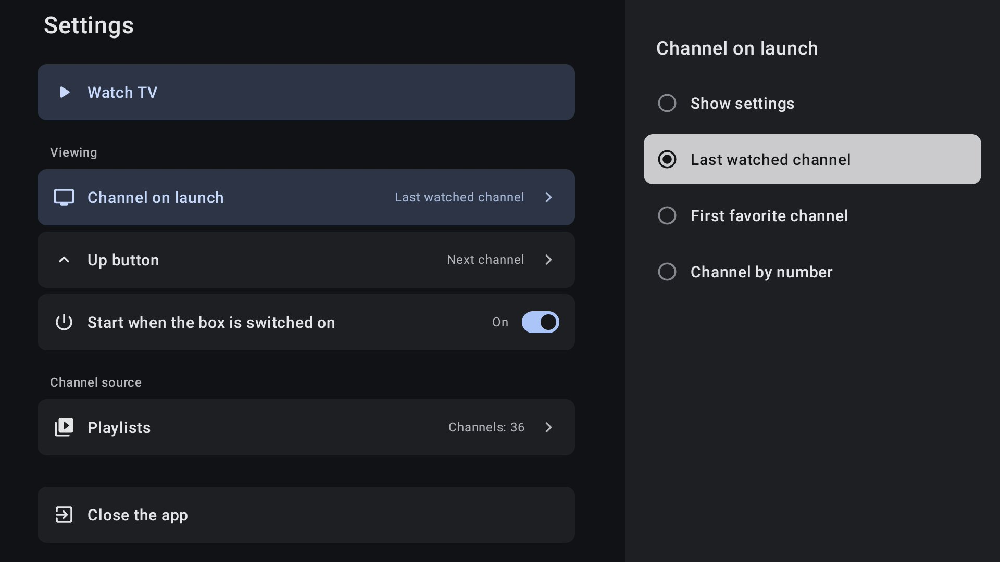

<p align="center">
  
</p>

<h1 align="center">Simple TV · Просто ТВ</h1>

<p align="center">
  <b>A minimal IPTV player for Android TV boxes. Minimum features, maximum picture quality.</b><br>
  <b>Простой IPTV-плеер для ТВ-приставок на Android. Минимум функций — максимум качества.</b>
</p>

<p align="center">
  <a href="https://github.com/uladzemer/SimpleTV/releases/latest"><b>⬇ Download APK · Скачать APK</b></a>
  &nbsp;·&nbsp; <a href="#english">English</a>
  &nbsp;·&nbsp; <a href="#русский">Русский</a>
  &nbsp;·&nbsp; <a href="#screenshots--скриншоты">Screenshots</a>
  &nbsp;·&nbsp; <a href="#keywords--ключевые-слова">Keywords</a>
</p>

<p align="center">
  <a href="https://github.com/uladzemer/SimpleTV">GitHub</a>
  &nbsp;·&nbsp; <a href="https://gitlab.com/uladzemer/SimpleTV">GitLab (mirror · зеркало)</a>
</p>



---

## English

Simple TV is an IPTV player built for one job: switch on the TV box and a live channel is already playing full screen. It is designed for viewers who do not want menus at all — elderly parents, kitchen TVs, waiting rooms, hotels.

- **Plays on power-on.** Turn on one setting once, and every time the box boots the last watched (or a chosen) channel starts full screen. No launcher, no menus.
- **Remote control only.** ▲/▼ switch channels, ◀ opens groups and the channel list, ▶ opens the channel menu, digits jump to a channel number, Back twice opens Settings.
- **Hardware video decoding.** Video goes through the box's own MediaCodec decoders, hardware first (H.264, HEVC, MPEG-2, 4K UHD where the chip supports it). FFmpeg is never used for video, so there is no slow CPU decoding that drops frames.
- **Correct audio sync.** AC3 / E-AC3 / AAC / MP2 are always decoded to PCM, with no HDMI passthrough, so playback speed is exact and the app volume works on every channel. Formats the box cannot decode itself, such as MP2, go through the bundled FFmpeg.
- **Stable live streams.** Playback stays 40 seconds behind the live edge with a 30–60 s buffer, a stall watchdog with soft resume (same player, same buffer), short network timeouts (8 s connect / 10 s read) and a hold-back of the newest segment for CDNs that announce segments too early.
- **Permanent channel numbers.** A number is the channel's place in the playlist file, not in a group, so the same digits open the same channel as long as the provider keeps the playlist order.
- **Big, readable UI.** Flat dark Google TV style, large type readable from three metres, English and Russian interface (follows the system language).
- **Private by design.** The app connects only to your playlist link and to the stream and logo addresses inside it. No analytics, no accounts, no ads, no update checks. (If Android system backup is on, settings and playlist links go into the device backup.)

Simple TV is **written from scratch** in Kotlin with Jetpack Compose for TV and AndroidX Media3 (ExoPlayer). The experience behind it comes from studying open-source players and libraries — Media3/ExoPlayer, FFmpeg, nextlib — and from long testing on a real ARM TV box.

**Tested on:** X96 X10 Pro (Amlogic S905X5, ARM64, Android 11), 1080p 50 Hz output, playlists with ~4,000 channels including 4K UHD.

### Quick start

1. Download the APK from [Releases](https://github.com/uladzemer/SimpleTV/releases/latest) and install it on the TV box (Android 8.0+, ARM).
2. Open Simple TV. With no playlist yet, Settings open automatically.
3. Enter your M3U / M3U8 playlist link (`http://` or `https://`) and press **Add**.
4. Check **Channel on launch** (default: last watched channel) and turn on **Start when the box is switched on** if the channel should start by itself after power-on (it is off after a fresh install). If it says a permission is needed, allow “Display over other apps”, or run:

   ```bash
   adb shell appops set ru.iptvsimple.tv SYSTEM_ALERT_WINDOW allow
   ```

Playlists refresh daily on their own; favorites are kept for channels that stay in the playlist.

### What it deliberately does not have

No EPG, no Xtream Codes, no VOD/movies/series, no RTMP/RTSP/DASH, no DRM, no phone UI, no themes. Fewer features means fewer ways for a non-technical viewer to get lost.

---

## Русский

«Просто ТВ» — IPTV-плеер с одной задачей: включили приставку — на экране уже идёт канал. Он сделан для зрителя, которому не нужны меню и настройки: для пожилых родителей, телевизора на кухне, приёмной, гостиницы.

- **Канал сразу при включении.** Один раз включите настройку — и после каждой загрузки приставки на весь экран идёт последний канал (или выбранный заранее).
- **Только пульт.** ▲/▼ — каналы, ◀ — группы и список, ▶ — меню канала, цифры — канал по номеру, «Назад» дважды — «Настройки».
- **Видео декодирует сама приставка** (MediaCodec, в первую очередь аппаратные декодеры: H.264, HEVC, MPEG-2, 4K UHD, если их поддерживает чип). FFmpeg для видео не используется, поэтому нет медленного программного декодирования, которое теряет кадры.
- **Точная скорость и звук.** AC3, E-AC3, AAC и MP2 всегда декодируются в обычный звук, без передачи «как есть» на HDMI. Видео не «замедляется», громкость приложения работает на всех каналах. То, что приставка не умеет сама (например, MP2), декодирует встроенный FFmpeg.
- **Устойчивый эфир.** Показ идёт на 40 секунд позади прямого эфира, буфер 30–60 секунд; сторож зависаний с мягким восстановлением (тот же плеер, тот же буфер), короткие таймауты сети (8 с / 10 с), самый свежий кусок эфира не запрашивается раньше времени.
- **Постоянные номера каналов**: номер — место канала в файле плейлиста (не в группе), поэтому, пока провайдер не меняет порядок каналов, одни и те же цифры включают один и тот же канал.
- **Крупный интерфейс** в плоском тёмном стиле Google TV, читается с трёх метров. Русский и английский язык — по языку системы.
- **Ничего лишнего в сети**: приложение обращается только к ссылке плейлиста и к адресам потоков и логотипов из него. Без аналитики, рекламы, аккаунтов и проверки обновлений. (Если на приставке включено резервное копирование Android, в копию попадут настройки и ссылки плейлистов.)

Плеер **написан с нуля** на Kotlin, Jetpack Compose for TV и AndroidX Media3 (ExoPlayer). Опыт взят из открытых проектов и библиотек — Media3/ExoPlayer, FFmpeg, nextlib — и из долгих проверок на настоящей ARM-приставке.

**Проверено на:** X96 X10 Pro (Amlogic S905X5, ARM64, Android 11), выход 1080p 50 Гц, плейлист около 4000 каналов, включая 4K UHD.

### Кнопки пульта

| Кнопка | Действие |
|---|---|
| ▲ / ▼, CH+ / CH− | соседний канал |
| ◀ (или «Меню») | панель: группы, избранное, список каналов |
| ▶ | меню канала: избранное, перезапуск, список каналов |
| цифры, затем ОК | канал по номеру (через 2 секунды включится и без ОК) |
| ОК | название и номер текущего канала |
| Пауза / Воспроизведение | пауза |
| «Назад» два раза | экран «Настройки»; «Назад» на нём — снова к каналу |

Плеер сам следит за картинкой (проверка раз в 2 секунды). Если канал остановился на загрузке посреди просмотра, плеер сначала пробует продолжить с того же места. Если не помогло, а также если канал не включился за 15 секунд или картинка застыла, он перезапускает канал и пишет «Канал завис, перезапускаю…». После трёх быстрых попыток следующие идут раз в 20 секунд.

### Первая настройка

Её один раз делает тот, кто ставит приставку.

1. Скачайте APK в разделе [Releases](https://github.com/uladzemer/SimpleTV/releases/latest) и установите на приставку (Android 8.0 и новее, процессор ARM).
2. Запустите «Просто ТВ». Пока плейлиста нет, сразу откроются «Настройки».
3. В строке «Добавить плейлист M3U» введите ссылку (`http://` или `https://`) и нажмите «Добавить».
4. Проверьте «Канал при запуске» (по умолчанию — последний канал) и включите «Запуск при включении приставки», если канал должен включаться сам после включения приставки (после установки он выключен). Если появится «Нужно разрешение», разрешите показ поверх других окон или выполните с компьютера:

   ```bash
   adb shell appops set ru.iptvsimple.tv SYSTEM_ALERT_WINDOW allow
   ```

Плейлист обновляется сам раз в сутки; избранное сохраняется у каналов, которые остались в плейлисте. Совет: если в настройках экрана приставки выбрать 1080p 50 Гц, движение на большинстве каналов будет плавнее.

Если каналы одной страны часто останавливаются, а остальные идут ровно, попробуйте сменить сервер раздачи (CDN) в личном кабинете IPTV-провайдера: часто дело в сервере, а не в плеере.

### Сборка

Нужны JDK 17 и Android SDK с платформой 37.

```bash
./gradlew :engine:testDebugUnitTest :app:tv:testDebugUnitTest   # тесты
./gradlew :app:tv:assembleDebug                                   # отладочная сборка
./gradlew :app:tv:assembleRelease                                 # релизная сборка
```

Готовый файл: `app/tv/build/outputs/apk/release/tv-<версия>-release.apk`. Ключ подписи в репозитории не хранится: путь к файлу с его параметрами передаётся свойством `iptvSimpleSigningProps` или переменными окружения `RELEASE_*`. Без ключа релизная сборка получается неподписанной — так её собирает F-Droid; для проверки на своей приставке без ключа есть отладочная сборка.

GitHub Actions (`.github/workflows/tv-simple.yml`) запускает тесты и собирает подписанный APK при каждом изменении ветки `master` (кроме правок только в `.md`) и по ручному запуску. Нужны секреты репозитория `RELEASE_KEYSTORE_BASE64`, `RELEASE_KEYSTORE_PASSWORD`, `RELEASE_KEY_ALIAS`, `RELEASE_KEY_PASSWORD`.

Ссылку на плейлист можно вшить в сборку: `-PtvDefaultPlaylistUrl=https://адрес/плейлист.m3u`. Такой APK никому не передавайте — ссылка лежит внутри него.

### Из чего состоит

| Модуль | Что делает |
|---|---|
| `app/tv` | приложение: заставка, полноэкранный плеер, панель каналов, меню канала, «Настройки», запуск при включении приставки |
| `engine` | ядро: база каналов и плейлистов (Room), чтение M3U, загрузка и ежедневное обновление плейлистов, настройки, плеер на Media3 |

---

## Screenshots · Скриншоты

Real captures from the TV box (Amlogic S905X5), English interface, international channels.
Снято на настоящей приставке, английский интерфейс, международные каналы.

| | |
|---|---|
|  |  |
| **On air** — channel number, name, group and remote hints | **Music channel** — 1080p, hardware decoding |
|  |  |
| **◀ Groups and channels** — permanent channel numbers | **▶ Channel menu** — favorites, restart, channel list |
|  |  |
| **Settings** — the only settings screen | **Channel on launch** — what plays after power-on |

---

## Keywords · Ключевые слова

IPTV player for Android TV box · simple IPTV player · M3U player · M3U8 player · HLS live TV player · Android TV IPTV app · TV box IPTV · IPTV for elderly · IPTV for seniors · big UI TV player · remote control only · autostart on boot · plays on power-on · kiosk TV player · hotel TV · Amlogic · S905X5 · X96 · ARM TV box · hardware decoding · 4K UHD IPTV · HEVC · H.264 · MPEG-2 · AC3 · E-AC3 · Dolby Digital audio decoding · MP2 audio · FFmpeg audio · Media3 · ExoPlayer · Jetpack Compose for TV · Kotlin · open source · GPL-3.0 · no ads · no tracking · no EPG · minimal · lightweight · stable live streams · stall watchdog

IPTV-плеер для ТВ-приставки · простой IPTV-плеер · плеер M3U · плеер плейлистов M3U8 · IPTV на Android TV · ТВ-бокс · приставка для пожилых · телевизор для родителей · плеер для бабушки и дедушки · крупный интерфейс · только пульт · автозапуск при включении · канал сразу при включении · аппаратное декодирование · 4K · без рекламы · без слежки · минимум функций · максимум качества · написан с нуля · проверен на ARM-приставке · Amlogic · X96

---

## License · Лицензия

© 2026 uladzemer. GNU General Public License v3.0 — see [LICENSE](LICENSE). If you share the APK, its source code must be available to the recipients too.
Если вы передаёте APK другим людям, им должен быть доступен и исходный код.
